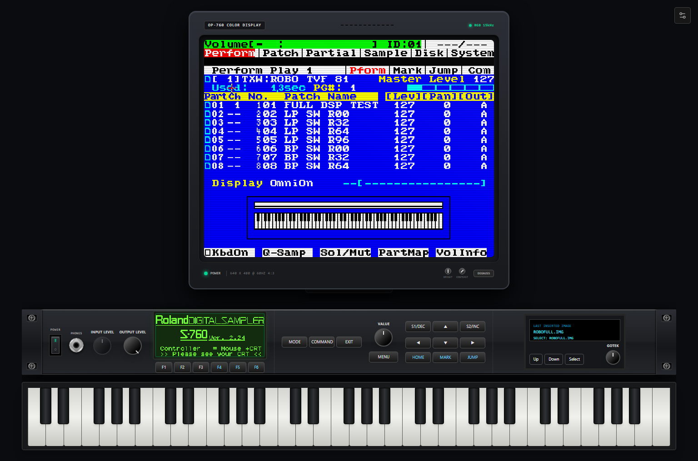

# Roland S-760 native emulator

An open-source Roland S-760 emulation project built around a modified MAME
runtime, a Windows standalone player and a native VST3 instrument. The original
firmware handles the sampler's interface and workflows; React/WebView2 displays
the live CRT/LCD frames and provides the rack controls.



Download the [standalone clean-machine acceptance kit](https://github.com/JefroB/s760-Emulator/releases/tag/standalone-acceptance-2026-10-17-v4).
See the [artifact index/checksum](artifacts/standalone/README.md) and
[test instructions](docs/testing/standalone-clean-machine-handoff.md). The user accepted clean-machine launch/setup; full media workflows were waived.

## Current status

As of **2026-10-17**, Milestones 1–5 are complete for their documented Windows
development profiles. **SoundCheck is the automated DAW/host acceptance framework.**
The [Milestone5 acceptance matrix](docs/testing/milestone-5-acceptance.md) records named
sampler workflows and firmware restrictions. [Dated packaged editing acceptance](docs/testing/milestone-6-packaged-editing.md) now covers
four named edits, firmware Save/cold Load and session restore through real browser controls.
The [2026-10-17 packaged crash-recovery check](docs/testing/milestone-6-crash-recovery.md)
adds three forced shutdown/relaunch cycles with exact dirty-disk and sample retention.
[Checkpoint-publication fault tests](docs/testing/milestone-6-checkpoint-publication.md)
also cover interrupted staging, Windows replacement denial and a successful retry.
The [actual WebView2 desktop window](docs/testing/milestone-6-webview-editing.md)
now passes all four named editing, Save, session-restore and cold-Load workflows.
It also passes a [normal-speed physical stereo sampling workflow](docs/testing/milestone-6-webview-sampling.md),
with firmware Save, session restore and exact sample retention after cold Load.
A [frozen candidate with the layered configuration UI](docs/testing/milestone-6-complete-standalone-workflow.md)
now passes two complete normal-speed load/play/edit/sample/save/restore/reopen cycles,
including measured Windows-device playback, physical input and independent native readback.
The [source-built standalone release archive](docs/testing/standalone-release-promotion.md)
now has source/dependency distribution qualification and passes two complete
workflows from its extracted bytes, with twelve independent native readbacks.
Its GPLv3 ASIO source and native/Python dependency sources accompany the package.
[Milestone 7](docs/project/completion-roadmap.md#milestone-7--editable-os-and-boot-rom-toolchain) is complete for its documented editable assembly, byte-exact rebuild, source-change and structured decompiler workflows for both the OS and boot ROM. The [toolchain guide](docs/firmware/tooling/firmware-toolchain.md) documents regeneration from user-supplied firmware; generated firmware exports stay local.
The user has [accepted clean-machine launch and firmware discovery](docs/testing/clean-machine-acceptance-2026-10-17.md), explicitly waiving full media workflows on that machine. Remaining final-release gates are recorded in [Milestone6](docs/project/completion-roadmap.md). This is a development project;
passing model or native-runtime tests does not establish complete hardware parity.

| Product | Qualified scope |
| --- | --- |
| Windows standalone | Original-firmware boot, live displays/controls, floppy load/save/export, MIDI playing, session recovery and supported 44.1 kHz MME/ASIO stereo sampling |
| Native VST3 instrument | SoundCheck SDK discovery, MIDI/controller effects, stereo output, offline rendering, optional 44.1 kHz input and same-build project save/cold reopen |
| GB-6 controller patches | Selectable 4th controller option (`GB-6 +CRT`, mode `3`) for IC15 Boot ROM v1.11 + OS 2.24 (`v8`/`v9`) verified in emulator (**not yet tested on real hardware**); legacy Mouse+CRT replacement patch (`patch_gb6_os.py`) `v8` vertical motion user-confirmed on hardware |

Native-runtime testing also qualifies named Akai S1000 Convert Load and native
Roland CD1 Load profiles. The full JMD Roland CD loads its K4 performance and79
byte-verified sample allocations, with playback/release and exact cold recall.
See the [native Roland results and limits](docs/condensed/validation/milestone-5-roland-scsi-load-2026-10-14.json).
Native HD0 initialization/Save/export/fresh Load also passes on the named10MiB profile;
[SCSI write limits](docs/condensed/validation/milestone-5-scsi-save-2026-10-14.json)
include explicit Python export only. Final packaged media selection/export remains unqualified.
The original firmware mutes Disk/Quick Load/Sampling displays; disk/MIDI tests qualify
safe completion and playback recovery, without musical continuity during disk operations.

Native plugin output processing is tested at 44.1/48/96 kHz. Input and project
profiles have narrower documented limits. Cross-build/rate/negotiated-maximum
project migration is unsupported; incompatible recall rejects explicitly. Raw
CC120/121 are unsupported by the qualified firmware profile; documented message
sequences provide panic/reset. Live Sampler FX is unadvertised; VST2/CLAP and the
historical core are diagnostic paths rather than qualified native products.

## Start here

1. Supply your own boot ROM and OS disk using [firmware setup](docs/emulator/guides/firmware-setup.md).
   Firmware, sample libraries, patched OS images and hardware captures are excluded
   from the repository and packages.
2. Follow the [standalone guide](docs/emulator/guides/standalone-player.md) or
   [VST3 configuration guide](docs/emulator/guides/native-plugin-configuration.md).
3. Use Configuration for firmware/media paths, MIDI and audio devices in standalone.
   In VST3, the host supplies audio/MIDI. Audio input and the on-screen keyboard
   are opt-in.

With a current native MAME build and Node/Python dependencies installed:

```powershell
python -m pip install -r scripts/requirements-standalone.txt
npm --prefix google-ui ci
npm --prefix google-ui run build
python scripts/s760_standalone.py
```

The desktop player requires Windows WebView2 Runtime. It does not download
firmware. See the guide for explicit paths, startup recovery and browser mode.

## Build and test

The qualified development environment is Windows x64 with Visual Studio 2022 C++
tools, CMake, Python and Node. The native MAME executable is built separately
from the CMake host/plugins; see the [native build/runbook](docs/condensed/11-native-boot-and-audio-runbook.md).

```powershell
cmake -B build -S core -G "Visual Studio 17 2022" -A x64
cmake --build build --config Release
.\build\Release\s760_core_tests.exe
.\build\Release\s760_plugin_tests.exe
python -m pytest tests
```

Some tests require local firmware, native artifacts or optional dependencies;
skips are reported separately. SoundCheck qualification uses actual native SDK
processing and measured PCM. See [SoundCheck projects](docs/testing/soundcheck-projects.md),
[controller tests](docs/emulator/runtime/native-vst3-midi.md), [rendering](docs/emulator/runtime/native-vst3-rendering.md)
and [host sampling](docs/emulator/runtime/native-vst3-sampling.md) for commands, identities and limits.

## GB-6 patching

> **Hardware testing status:** The selectable 4th controller (`GB-6 +CRT`, mode `3`) Boot ROM + OS 2.24 patch has been verified end-to-end in the native MAME emulator, **but has not been tested yet on real S-760 hardware.** Always keep your original IC15 Boot EPROM and original OS 2.24 floppy/Gotek image untouched as a rollback baseline.

The repository includes reproducible Python patchers that operate on copies of user-supplied original firmware (`Roland_S-760_v1.11.BIN`, SHA-256 `ef3b095445bbc1213e1b7ab38dc32a12dc2a0cb6aee3a7b845ff648c1941efc6`; `S760224.IMG`, SHA-256 `3827ed4c46fd48abbec3095266164853033141d7bd15afe8dda0050d00e073cd`). Only the patch scripts, tests and documentation are committed to Git; original and patched `.BIN`/`.IMG` binaries remain local and git-ignored.

### 1. Selectable 4th Controller Option (`GB-6 +CRT`, Mode `3`) — Boot ROM + OS 2.24

Adds `GB-6 +CRT` (mode `3`) alongside `Panel+LCD` (`0`), `Mouse+CRT` (`1`) and `RC100+CRT` (`2`) in both the IC15 Power-On `Mode` Setup Menu and the OS 2.24 `System -> System PRM -> Page 2` menu while preserving `Mouse+CRT` and `RC100+CRT`:

```powershell
# Patch both IC15 Boot ROM v1.11 and OS 2.24 System Disk (default v9 = X*4, Y*4; or --profile v8 = X*8, Y*4)
python scripts/build_gb6_combo.py --boot-input roms/BOOT/Roland_S-760_v1.11.BIN --os-input S760224.IMG --out-dir temp/work/gb6_combo --profile v9

# Or patch the Boot ROM and OS Disk individually:
python scripts/patch_gb6_boot_rom.py --input roms/BOOT/Roland_S-760_v1.11.BIN --output temp/work/gb6_combo/Roland_S-760_v1.11.GB6.BIN
python scripts/patch_gb6_os_disk.py --input S760224.IMG --output temp/work/gb6_combo/S760224.GB6-v9.IMG --profile v9
```

| Output artifact | Size | Modified bytes | Output SHA-256 |
| --- | --- | --- | --- |
| `Roland_S-760_v1.11.GB6.BIN` | `32,768` (`0x8000`) | 13 bytes | `a0a980e284f18ee6f6854c3b37a1d88c06dd21548fb7ae488ac213c47798c2fb` |
| `S760224.GB6-v9.IMG` (`X*4, Y*4`) | `1,474,560` (`0x168000`) | 220 bytes | `0a15c81ad6747803160815393f2c2c207f15861bd5671d349ebde4aa3929af15` |
| `S760224.GB6-v8.IMG` (`X*8, Y*4`) | `1,474,560` (`0x168000`) | 220 bytes | `6e32e3143dd06b2d93bdacaf765fd2ba68edeb2b64916dbf0d528262573b7403` |

To emulate the Sony GB-6 trackball protocol on `0xF008` in the native emulator, pass a config file (`S760_CONFIG=s760_config.json` with `{"pointing_device": "gb6"}` or `"auto"`) or set `S760_POINTING_DEVICE=gb6`. Run `python -m pytest tests/test_gb6_combo.py` to execute the automated disassembly and emulator verification suite.

### 2. Legacy OS-Only `Mouse+CRT` Replacement Patch

The [GB-6 patch guide](docs/firmware/os/gb6-os-patch.md) also documents `scripts/patch_gb6_os.py`, which replaces the `Mouse+CRT` movement decoder in-place without requiring a Boot ROM change. See the [controller plan](docs/project/gb6-controller-plan.md) for background and EPROM notes.

## Documentation

Start with the [documentation guide](docs/README.md) for task-based navigation and
topic indexes covering setup, runtime, firmware, hardware, testing and plans.

- [Completion roadmap](docs/project/completion-roadmap.md): completed gates and remaining work.
- [Condensed technical references](docs/condensed/README.md): hardware, firmware and evidence.
- [Media library](docs/emulator/guides/native-media-library.md) and [sessions/recovery](docs/emulator/guides/native-sessions.md).
- [Sampling](docs/emulator/guides/native-sampling.md), [rack controls](docs/emulator/guides/native-rack-controls.md)
  and [plugin state](docs/emulator/runtime/native-plugin-state.md).
- [Bug backlog](docs/project/bug-backlog.md): known defects and their resolutions; BUG-060 functional QA now explicitly negotiates offline processing.
- [Packaged media recovery](docs/testing/milestone-6-media-recovery.md): eight unformatted-media/reload cycles and dirty-session guard/export acceptance with cold native sample/audio checks.
- [Packaged setup guide](docs/emulator/guides/standalone-package-readme.md) and [relocation acceptance](docs/testing/milestone-6-package-setup.md): self-contained instructions, startup repair and profile reopen without development environment variables.
- [Distribution qualification](docs/testing/distribution-qualification.md): exact dated standalone artifact review;
  final packages and clean-machine release acceptance remain open.

`mame-source/` contains the native engine, `core/` the C++ host/plugins,
`google-ui/` the shared interface and `scripts/` the runtime and verification tools.
Historical coverage catalogs are inventories, not claims of complete product acceptance.
The [Milestone6 claim audit](docs/testing/milestone-6-coverage-audit.md) records the reviewed
historical claims and passing catalog safeguards; clean-machine release checks remain open.

## License and attribution

Project-owned code is [BSD-3-Clause](LICENSE); MAME and other dependencies retain
their respective licenses and notices. See the distribution review before packaging.
The source-built ASIO-enabled standalone distribution carries GPLv3 obligations;
its source delivery and component terms are documented in the
[release candidate review](docs/testing/standalone-release-promotion.md).
Roland and other product names belong to their owners. This independent project
is not affiliated with or endorsed by Roland Corporation.
