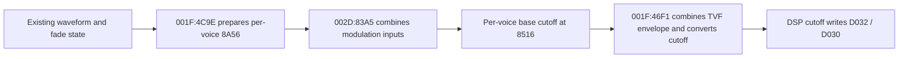

# Filter modulation dataflow recovered from bounded OS analysis

The newly decoded routines connect modulation-state preparation to the base cutoff consumed by the existing integer cutoff calculation. This is a static original-firmware finding, not a new hardware timing measurement or a renderer fix.

## The active voice-service branch

With instruction selectors 0102=001F and 0104=002D, the service branch calls 001F:4C9E at 4415, then 001F:480C at 441F, 002D:83A5 at 4422, and 002D:8000 at 442D. There are other service branches. Intervening callee bank preservation remains a context requirement, not a whole-program proof.

The data addresses below are CPU addresses with per-voice indices, not file offsets. Data page 02BE supplies the 8000–BFFF window in the timer-service context. Parameter reads in the 4000–7FFF window select separate data pages 032A/033A/0356. Instruction pages must not be substituted for either data mapping. OS instruction file offsets use `0x4800 + (page << 10) + (PC & 0x3FFF)`.

## Output is prepared before the next waveform-state update

001F:4C9E loads signed per-voice contributions, selects parameter data, clamps a combined rate-related index to 1..127, and uses table A3EE to calculate the word stored at 8B46. Semantic labels for individual contributing parameters remain provisional.

4D58–4DB6 prepares the output at 8A56 from existing state at 8A86 and fade-related state. Every decoded route from this section joins at 4DBB. Only then does the firmware load the shape index at 8BA6, mask it with 7, and dispatch through `4DCC + 2*index`. The eight stubs lead to waveform-state updates. Thus this routine's current output precedes its next waveform-state update. This ordering alone does not establish a full control-tick delay at the physical filter or explain the recorded opening/closing discrepancy.

The decoded cases include alternating saturated ramps, wrapping half-step ramps, table interpolation using A0E4/A0E6, binary output from a phase bit, an endpoint-triggered arithmetic recurrence, and bounded one-way ramps. Their correspondence to user-facing waveform names and hardware phase behavior still needs independent checking. The table references are evidence of data use, not complete table-boundary or value validation.

## The modulation output feeds cutoff directly

002D:83A5 combines base words at 8546/8576 and additional words at 8966, 86F6 and 8846, plus signed parameter/key-related arithmetic. At 8460–8493 it sums signed depth contributions from 4077, 8667, 88A7 and 87B7, clamps the sum to -63..63, and prepares it for multiplication. At 8496 it multiplies by the output at 8A56. The accumulated result is saturated to 0..32767 and stored at 8516 by 84C1.

001F:46F1 reads that same 8516 word at 4795 or 47A3 while combining the TVF envelope contribution. It then performs the previously audited table interpolation and writes D032/D030. This identifies an upstream producer that the earlier bounded cutoff view did not explain. It does not imply that the existing native firmware execution omits this producer.

## Both initial-counter branches write the companion cutoff

Expanding the initialization window back to 002D:925C reveals a branch on the counter at 83C6:

- Zero counter: select the envelope value at 8306, calculate cutoff, call the 46C2 delay, write D022=0/D020=cutoff, and jump to 8048.
- Nonzero counter: set stage 2 at 8C1E, select the value at 8396, perform the same calculation/delay/companion writes, and jump to 8000.

The companion pair is therefore not exclusive to the zero-counter branch in the decoded firmware. Physical meanings of D020/D022 and command register D018 remain unqualified. Earlier captured initial pairs remain valid; no claim is made that this new static branch analysis was exercised in those captures.

## Verification and remaining work

The manifest now includes both initialization branches, all eight masked waveform-dispatch targets, the modulation mixer and the amplitude writer. All expanded regions decode without warnings. The [validation record](../../condensed/validation/filter-modulation-dataflow-2026-10-16.json) includes input/tool identities and exact instruction anchors checked against the generated analysis. Generated firmware assembly remains local.

Next useful checks are a read-only native trace of 8A56 → 8516 → cutoff writes on the existing fixture, and data-table characterization using the proven data-page context. Those checks can establish whether the newly explained modulation path is active in the mismatching recording before changing any timing or filter model. Boot-ROM DSP setup and complete command semantics remain open.
