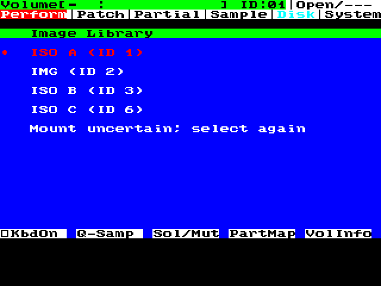

# IM1 cancellation and interrupted-mount recovery

The later [IRQ/ownership results](bluescsi-im1-irq-ownership-results-2026-10-19.md) supersede this partial census: conditional IRQ/MIDI service, service-time accounting and late incoming-SDS admission now pass at7,876/8,002 bytes. The masked-callback measurements below remain historical evidence for their named hash.

**Date:**2026-10-19. **Decision:** IM1 OPEN. [Native validation and exact sources](../condensed/validation/bluescsi-im1-cancel-recovery-2026-10-19.json) qualify private candidate `668105f92fc19cf945cd638dcf81cc029e47addb6733b8d63c41662a3fb3d30f`. Selectable **GB-6 v9 X4/Y4**, discovery and all retained SDS repairs remain included. The existing selectable boot ROM is unchanged. All acceptance uses ordinary GB-6/panel/MIDI inputs and read-only observers; no guest RAM/register/PC forcing.

## Cancellation contract and native results

The operation clears its cancellation latch once, at callback entry. It enables the existing raw front-panel Exit scanner while commands run, drains the current bounded command and stops before issuing another command. Raw transport failures and CHECK CONDITION retain precedence; cancellation after a successful exchange is operation result7. The scanner also runs after command return and during readiness waits.

| Check | Observed result |
| --- | --- |
| Failing preceding build | A203ms physical Exit press starting at D7 byte1200 is ignored: mode1/error0/cancel0. BUG-150 records the gap. |
| Listing cancellation | The same timed press is accepted; all4,000 wire bytes drain with raw status0/transport0, no D8 follows, and the browser shows **Cancelled**. Native drive and allocation cursor remain unchanged. |
| Listing retry | A fresh collection selection clears the latch, fetches all100 rows and reaches page15/index99 normally. |
| Switch interruption | Exit pressed at D8's first command byte is held until the guest accepts it14.84675ms later. D8 drains with raw status0; no subsequent command or native Load is queued. Native drive and sample cursor remain unchanged, and the browser visibly shows **Mount uncertain; select again**. |
| Explicit fresh selection | A new catalog/image selection reissues index99, completes readiness/capacity and native Load without manual Scan. All13 samples/119,808 expected B bytes match, with playback/release. |
| Retained SDS repairs | After loading, early receive CANCEL settles13/0; retry reserves14/1 and publishes14/0 with160 exact appended PCM bytes. All13 previous descriptors/119,808 PCM bytes and every packed code span remain exact. |

The switch result deliberately makes no rollback claim: D8 may already have changed the mounted image. Native Load is only queued after an explicit successful selection. The original interrupted selection is not silently resumed.

Readiness probes are paced20ms apart, including before the first probe, for at most four attempts. Each wait checks Exit and has both a TIMER1 bound and finite poll count. Command deadlines are additional; this does not promise an80ms whole-operation deadline or establish physical reinsertion timing. A preceding test released Exit after only0.821375ms, before the panel sampled it. BUG-151 corrects that test to use a held physical press; the failed run is retained and excluded.

## Error recovery and catalog boundaries

A present ordinary target is refused after its36-byte INQUIRY, before any Toolbox command, and **SCSI error** is visible. The fixture also reproduces the source-backed D8 failure-reporting gap (BUG-137): selecting an empty backing image returns D8 GOOD but leaves media unavailable. The browser performs four bounded TUR/sense attempts, returns to collections with **Mount uncertain; select again**, and does not change the native selected drive or queue Load. Reopening that target's catalog works; choosing a valid image on a different target then loads13 samples/119,808 exact B bytes with playback. No reset or unrelated mount is used.

Empty, one-entry and100-entry catalogs pass again on this exact hash, including all32 bytes of every100-entry filename and exact compact rows. A101-entry DA returns CHECK CONDITION, shows **SCSI error**, and is not followed by D7. Every accepted run leaves its library unchanged. All browser/SDS code spans survive the snapshots. The fixture's size/geometry/open rules are bounded test behavior, not physical BlueSCSI parity.

## Updated partial fit

| Component | Physical address | Bytes |
| --- | --- | ---: |
| Retained SDS helpers |3D3E/3FBE/405E|831|
| Browser, transport, discovery, cancellation and paced readiness |4080|2,773|
| One100-entry compact listing |4B80|3,400|
| Screen resources/signature/messages |58D0|739|
| Context |5BC0|92|
| **Named total / region** | |**7,835 /8,002**|

The167 residual bytes are split3/43/8/13/100. Only43 are contiguous after browser code. This adds252 named bytes to the preceding discovery candidate; it is still not the complete feature footprint. Callback local frame remains80 bytes, excluding deeper helpers/native callers/ISRs. Static instruction/branch/indirect-target/interval audits, fresh byte-exact rebuild and immutable-original hashes pass. No emulator/runtime source changed; the preceding748-test backend baseline was not rerun for firmware-only work.

## Remaining gate

The SCSI callback still masks IRQs. Prove the caller IRQ context and safe service/MIDI behavior before treating cancellation as a production timing result. General native load/save/format ownership, relocated remote/local SDS sender paths, full stack/ISR bounds, complete footer/help/identity/error presentation, filename filtering/prefix policy, geometry/stereo/cache/reset/checkpoint behavior, writable Save/cold Load and remaining controller/physical qualification remain open. Earlier IMG/repeat/controller acceptance belongs to earlier hashes; current exact Load runs cover ISO targets1 and3.

Separately, the user confirmed on real S-760 hardware that patched-boot-ROM front-panel GB-6 selection works and survives restarting. That report qualifies selection/persistence only; it does not identify the installed binary hash or qualify this browser on hardware. See the [active roadmap](bluescsi-image-mount-plan.md).
