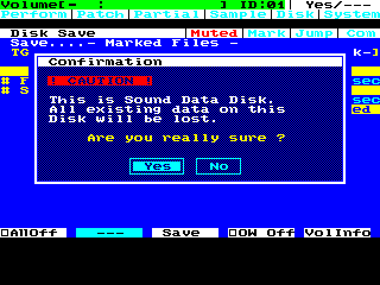
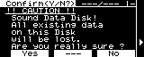

# IM1 Format, floppy operations, native callees and warning correction

**Date:** 2026-10-20. **Decision:** IM1 remains open. Eleven native cases pass, including the requested correction to Roland's incomplete disk warning. BUG-171 (fixture FORMAT UNIT) and BUG-172 (wording) are fixed. Native synchronous-callee stack analysis is complete for the linked browser; caller ancestry, interrupt assumptions, timing and recovery remain separate gates.

The [validation record](../condensed/validation/bluescsi-im1-format-fdc-stack-2026-10-20.json) contains exact identities, case results, matched command rows, build results, analysis sources and limitations. The [working plan](bluescsi-image-mount-plan.md) distinguishes current evidence from earlier checkpoints. Original OS, boot ROM and library inputs remain unchanged. Native acceptance uses ordinary input and read-only observers; synthetic SPC commands qualify the fixture separately.

## Corrected disk warning

Both CRT and LCD now say **“All existing data on this Disk will be lost.”** The dynamic disk label is retained. The four resources cover Sound Data and generic disk replacement warnings: CRT file offsets `0xC162C`, `0xC196C`; LCD `0xC168F`, `0xC19CA`. Each replacement occupies exactly its original extent. Only 170 bytes differ per complete OS image; there is no code relocation or allocation growth.

The reusable [patch script](../../scripts/patch_disk_warning_text.py) verifies source length and all original resource bytes, and refuses to overwrite an existing output. Both combined OS builders include it. Native CRT Sound Data Save and LCD Utility/Format cases pass on both successors. CRT No and front-panel LCD **F3/No** preserve the private media; LCD returns to Utility. All four loaded resource spans match the patch. Confirmation behavior is unchanged.

## Binary scope

| Artifact | SHA-256 | Scope |
| --- | --- | --- |
| Established predecessor | `6297274dd5c33b0b37409d3cddcd53e40b8af6140f2c416fc0213181cd3ba628` | Existing acceptance baseline; 6,452/8,002 bytes, 1,550 free |
| Established wording successor | `ecdbd721543bfbdc0cffe095f28b64185931d9583c3e5aaa3a99e6c26dbc0c36` | Four warning resources only; same allocation |
| Timing trial predecessor | `367f067d78c8e69a1b670efda1d7146b8843d79c59c16ab207df0fdbc0ce496c` | Seven operation cases and static stack analysis here |
| Timing trial wording successor | `791246920fff404e39dd0dc7fbb0305eee53439adfad86e2b40396f0f0f26f0c` | Four warning resources only; still experimental |
| Emulator before BUG-171 | `4cf1cfabaab8d3a9068ddac0ec81f60afb0dc92c903ae66cb5ed4ddac58fc4ee` | Convert and FDD read cases |
| Emulator after BUG-171 | `57e45eaf6fa298b38f3454f4a2a8449c7e1569419b3f38fdfda9a0f4e1f613ec` | Format, FDD write/cold load/format, four wording cases |
| Selectable GB-6 boot ROM | `a0a980e284f18ee6f6854c3b37a1d88c06dd21548fb7ae488ac213c47798c2fb` | Unchanged; mandatory GB-6 v9 retained |

The timing trial remains 6,580/8,002 bytes, with 1,422 free and 1,191 in its largest code gap. Its wording successor is not promoted. Earlier functional matrices were not all rerun on the wording successors: exact resource-only delta audits and four native display/No cases supplement predecessor evidence without relabeling it.

## Native operation coverage

| Cases | Observed result |
| --- | --- |
| Akai Convert Load with Disk/Mode input during reads | No Toolbox commands; 1,488 clusters, 30 samples/15 L/R pairs, 13,568,196 exact PCM bytes; three notes, release and browser Exit preserve playback |
| Stereo FDD Load with a two-second Disk/Mode pulse overlapping reads | No Toolbox commands; 26 clusters and 239,616 exact bytes, distinct L/R playback/release and browser Exit |
| Mounted 32 MiB IMG, full Format option, Verify No and Yes | Both finish native initialization with a valid empty Roland header; Mode overlaps actual writes without Toolbox commands |
| FDD Save with Mode during writes, followed by independent cold Load | Native Save/export completes; fresh process restores 26 clusters and 239,616 exact bytes, L/R playback/release and browser Exit |
| Native 720 KB FDD Format with Mode during FORMAT TRACK | 160 track formats plus header revision 161; all 733,184 bytes after offset 4,096 equal fill byte `0F`; browser Exit returns to Utility |

These seven cases extend the named input-exclusion matrix. They do not prove all aliases or concurrent DMA ownership. The four wording cases above bring this batch to eleven. Across them, **91 RAM snapshots** preserve all **7,360 immutable/gap bytes**, excluding the same 642 declared mutable bytes; timing-trial parser hooks and warning resources are also checked where applicable.

## FORMAT UNIT and Verify Medium are separate operations

The pinned [BlueSCSI disk implementation](https://raw.githubusercontent.com/BlueSCSI/BlueSCSI-v2/5e64e3b4a09088c67a2a6728385600ea67ddbe0d/src/BlueSCSI_disk.cpp) accepts the S-760's no-parameter `04 00 00 00 00 00` FORMAT UNIT without erasing backing data. Source SHA-256 is `fd7f18accd4aaec20e6ce40c85261bbbd9fa17415ac9b4d19239e5461aced3f8`. The native S-760 then writes its disk structures. Calling this a full-surface erase would be incorrect.

BUG-171 repairs that observed form in the opt-in image fixture. Synthetic coverage checks repeated non-erasing success, exact retained data/capacity, five invalid field forms, optical write protection, and unchanged unsupported behavior for an ordinary target. Other parameter-list variants are deliberately outside this implementation.

A separate complete command census shows Verify Medium uses single-sector READ(10), not SCSI VERIFY. It reads **65,535 sectors in descending order, LBA 65,534 through 0**, before initialization writes. **LBA 65,535 is omitted** on this 65,536-sector image. BUG-173 records that observed coverage defect; original-firmware comparison and cause analysis remain open. This census is supporting evidence, not a twelfth acceptance case or proof that every surface sector was verified.

## Native synchronous stack composition

The bank-aware callee graph resolves all ten helpers used by the browser through **46 contextual functions and 904 unique instructions**, with no unresolved edges or unbalanced returns. CE14/CDED far wrappers are decoded separately: 12 saved bytes plus the two-byte synthetic return, with the caller's two-byte LCALL accounted at its actual site. Selector restoration and explicit page-4B reassertion are checked.

| Native helper | Local maximum excluding incoming return |
| --- | --- |
| `000F:2080` event / `0000:F0A8` screen queue | 6 / 8 bytes |
| `003B:64FA` LCD text / `003B:62C7` LCD glyph | 10 / 4 bytes |
| `004B:4AEE` CRT fill / `004B:42A7` glyph / `004B:4550` text | 0 / 0 / 6 bytes |
| `0196:9460` highlight / `0196:94D9` CRT action / `0196:9798` LCD action | 2 / 50 / 50 bytes |

Composed browser plus synchronous-callee maxima are action 166, Exit 90, init 112 and update 166 bytes, including the 80-byte common frame. Thus **166 bytes now includes the reachable native synchronous callees**. The trial IRQ graph covers 152 functions/9,212 instructions; its conditional 62-byte contribution still depends on recorded state and interrupt assumptions. Native dispatcher ancestry, nesting and state invariants remain unproven. Adding 166 and 62 is not a valid total-stack proof.

## Regression results and excluded probes

Serial VS2022 native-driver and executable builds succeeded with `/Z7`; executable identity changed as expected. The serial backend suite reports **1,067 passed, 3 skipped**, no failures/errors. The skips are the existing from-scratch boot/property and complete assembler relink cases, with exact reasons retained in the validation. An initial concurrently loaded run had 975 passes and a checkpoint socket timeout; the focused repeat and subsequent full serial run pass.

Ordinary fixture-disabled native boot, pointer input, MIDI note/release and clean shutdown pass before and after the driver change. All **33,554,432 wave-memory bytes** are identical, SHA-256 `a6a2fdc2e0afbbe863f1f64240c7627bf5fa309023a485884f7b143412d25699`.

Write-reset probes are excluded: MAME performs the relevant DMA transfer synchronously, and pause/reset observation occurred after a write had completed. They did not isolate a mid-transfer reset. Early short input pulses, incomplete Save confirmations and incorrect LCD button probes are likewise excluded; their corrected cases are identified in the validation. No guest RAM, PC or register edits supplied acceptance.

The remaining IM1 work is BUG-168 worst-case service/deadline proof, dispatcher/IRQ stack assumptions, indirect ownership and DMA aliases, other recovery phases including native-write reset, and triage of BUG-173. Physical S-760/BlueSCSI configuration, actual library and timing/write qualification remain separate. RC-100 input stays user-waived and assumed compatible.
